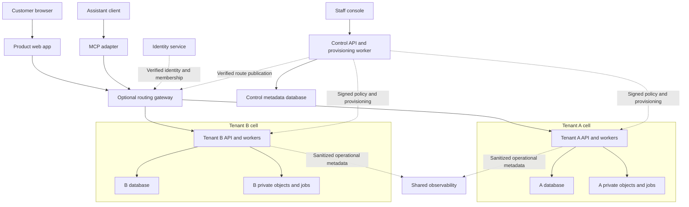

# Reusable polyrepo SaaS architecture

This reference generalizes the architecture developed in Ravelo into a design that can serve another business domain. It describes responsibilities, contracts, isolation and operational behavior without prescribing a cloud, identity, database, model or observability provider.

**Status: reference architecture, September 28, 2026.** The starter currently implements the smaller customer-cell baseline documented in [the existing architecture guide](../architecture.md). This documentation does not install a control plane, split repositories, add MCP, or change deployments. [ADR 0008](../adr/0008-optional-polyrepo-platform.md) records the optional expansion path; [adoption and implementation status](adoption.md) distinguishes executable starter behavior from future work.

## Read the architecture

| Guide                                                           | Decisions it helps make                                                                                  |
| --------------------------------------------------------------- | -------------------------------------------------------------------------------------------------------- |
| [Repository boundaries](repository-boundaries.md)               | Where code lives, why to split it, how contracts cross repositories and how releases stay compatible     |
| [Tenants, control plane and runtime](tenant-control-runtime.md) | What a tenant owns, how requests reach a cell, how policy/provisioning work, and where functions execute |
| [Shared systems](shared-systems.md)                             | Design system, evals and prompts, integrations, mocks, assurance and telemetry                           |
| [AI and MCP](ai-and-mcp.md)                                     | How assistant clients reuse application authorization, propose changes and obtain meaningful approval    |
| [Adoption in another domain](adoption.md)                       | Which parts exist here, domain mappings, incremental extraction and acceptance criteria                  |

## The architecture in one view

Keep business authority inside customer cells. Share the platform services that operate those cells and the packages that make products consistent. Deploy many cells from the same versioned product source.

This is a logical diagram, not a mandatory project count. MCP may be an entry point of the existing gateway/API. Each API may have several function handlers. A worker may use a queue, a durable workflow engine or a leased database job. Direct cell routing can replace the shared gateway. A shared web application is optional; the current starter deploys a separate web application per customer. The API remains responsible for authorization in every variation.

## Four independent boundaries

1. **Source ownership:** a repository owns a product or a reusable capability and releases it independently. A repository can contain several apps and packages.
2. **Runtime isolation:** a cell contains the credentials, compute bindings, database and private artifacts for one tenant. A source repository can produce hundreds of cells.
3. **Business authorization:** organization membership, roles and allowed workspaces determine what a person or service can do inside that tenant.
4. **Lifecycle isolation:** development, preview, test and production use explicitly separated identities, routes, secrets and persistent resources.

Neither a separate repository nor a tenant selector establishes data isolation. Neither a paid entitlement nor staff access establishes customer permission. These boundaries must meet at the server that performs the operation.

## Principles to carry between domains

**One business authority.** Browser routes, REST endpoints, MCP tools and background jobs call the same validated application services. Prices, quantities, state transitions, access checks and idempotency are ordinary deterministic code. A model can propose an operation; it cannot grant itself authority.

**Local execution, central administration.** The control plane records desired lifecycle state, resource references, subscriptions, capabilities, rollout state and audit metadata. A tenant owns its records, documents, external account credentials, authoritative business topology and applied operations. Customer requests use locally verified policy; a control-plane outage has a specified freshness/revocation contract instead of silently enabling features or stopping every read.

**Contracts over checkout coupling.** Shared UI and prompt configuration arrive as immutable packages. HTTP, tool and event contracts declare versions and compatibility. Runtime services never import source from a sibling checkout or query another service's database merely because both repositories are nearby.

**Provider details stay at the edge.** Adapter implementations translate identity claims, database transactions, object access, queue delivery, model responses and deployment operations. Portability means explicit semantics and replaceable integration points. It does not require a lowest-common-denominator abstraction for every vendor feature.

**Evidence follows the release.** Record source revisions, package digests, schema and contract versions, deployed identity and actual checks. Mock success proves a bounded contract. Local success does not establish hosted authentication, recovery, provider fidelity or customer acceptance.

## What to adopt first

Start with one product repository, one real API boundary and isolated customer storage. Add an extracted design system when several independently released interfaces need it; add an evals repository when experiments and prompt releases need an independent lifecycle. Introduce a control plane when manual provisioning and fleet rollout have measurable costs. Add a protocol adapter when a supported assistant client needs access to established domain operations.

The full polyrepo map is an expansion path. A small team can keep most modules in one repository while preserving the same ownership and security boundaries. [The repository guide](repository-boundaries.md) explains when extraction pays for its coordination cost.
