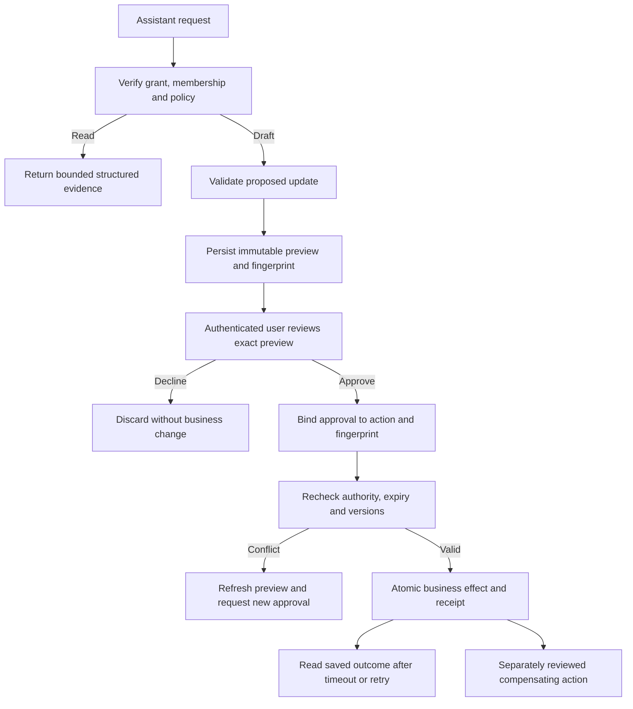

# AI collaboration and delegated assistant access

This is a reusable target architecture, not a claim that the starter implements an assistant platform. Today the starter offers an authenticated collaborator that returns a validated reply and optional field suggestions. Applying a suggestion changes browser draft state; saving is a separate user action through the content API. The default provider is deterministic. There is no MCP server, delegated authorization, durable approval receipt, operational undo, or signed assistant-access policy in the starter.

The baseline lives in [`collaborator.ts`](../../apps/api/src/collaborator.ts), [`contracts`](../../packages/contracts/src/index.ts), and [`ItemEditorPage.tsx`](../../apps/web/src/pages/ItemEditorPage.tsx). The remainder describes extensions a product can adopt deliberately. A documentation example does not activate these capabilities.

## One business authority, several interfaces

Keep domain rules and authorized application services in the product repository. Browser HTTP routes, background jobs, and a future Model Context Protocol (MCP) adapter call that same layer. An assistant adapter must not become a second implementation of permissions, calculations, or persistence.

An embedded collaborator uses trusted backend orchestration to call a model and return validated suggestions. A connected external assistant already performs reasoning: its MCP read tools can return deterministic application results without another model call. Neither model receives database credentials. Request fields cannot choose database connections, arbitrary upstreams, or deployment environments.

In a multi-cell deployment, a gateway can host protocol discovery and routing without business credentials. It resolves an operator-controlled route to the bound tenant's MCP handler within the same protected resource. That handler independently verifies authority and constructs a scoped repository. With one cell, the adapter can remain within its API. A separate protocol deployment is an operational choice, not a required repository boundary.

An evaluations repository owns synthetic cases, scoring, and versioned prompt configurations. Authorization, runtime schemas, deterministic rules, parser implementation, and secrets remain application responsibilities. A prompt release cannot widen permissions or redefine approval.

## Delegated authorization

The chosen HTTP authorization baseline is [MCP specification 2025-11-25](https://modelcontextprotocol.io/specification/2025-11-25/basic/authorization): protected-resource metadata, resource audience validation, authorization-code proof-key binding, and no token passthrough to downstream APIs. Verify discovery and authorization against each actual assistant host; choosing a protocol version does not establish host compatibility.

Treat assistant credentials separately from browser sessions. A grant should bind the verified user, registered client, resource audience, issuer, lifecycle, tenant, selected operating scope, allowed actions, and expiry. One selected scope per connection is easier to explain and revoke than implicit wildcard access.

Use an authorization-code flow with proof-key binding, exact registered redirect addresses, short-lived codes and access tokens, rotating refresh credentials, and explicit revocation. Persist credential hashes where the token design permits it. Validate the resource and recipient; never forward a delegated token to an endpoint that accepts only first-party sessions. Token routing hints identify a candidate route, not access authority.

Effective access is the intersection of several independent checks:

| Check                                     | Question answered                                                              |
| ----------------------------------------- | ------------------------------------------------------------------------------ |
| Runtime enablement                        | Is this deployment serving assistant access and, separately, writes?           |
| Tenant policy                             | Is the capability enabled for this tenant and lifecycle?                       |
| Account policy                            | Is this exact account permitted where a private rollout requires an allowlist? |
| Current membership and application grants | Can this person access the selected records and action now?                    |
| Delegated scopes                          | Did this connection receive the required bounded permission?                   |
| Command approval                          | Has the user approved this exact action and version?                           |

A paid plan, staff role, connection consent, or model assertion supplies none of the other checks. Re-evaluate current policy and membership during consent, token exchange, refresh, execution, and approval. Missing or expired optional-capability policy denies assistant access. Core application outage continuity may follow a different policy. Disabling access blocks later calls but cannot retract data already delivered to an assistant or reverse committed work.

## Bounded tools and explicit results

Design tools around user workflows rather than exporting the entire API. A domain-neutral starting set is `get_context`, `query_records`, `get_summary`, `draft_update`, `get_update`, `list_my_updates`, `apply_update`, `undo_update`, and `discard_update`. These are illustrative names, not implemented starter tools.

Inputs and outputs need strict schemas, unknown-field rejection, bounded strings and collections, explicit decimal representation, and consistent error categories. Validate a model's structured output even when its provider promises schema conformance. Returned records should include the selected scope, lifecycle, source references, state version, observation time, truncation, and known coverage gaps. Unknown values must remain unknown rather than becoming zero. A bounded response does not guarantee bounded query cost; design indexes and execution limits too.

Allowlist disclosed fields. Do not expose private source files, internal notes, actor identities, credentials, arbitrary SQL, shell execution, or unrestricted URL fetching through a general tool. Tool descriptions and host annotations improve presentation; server authorization remains mandatory.

## Draft, review, apply, reconcile

For consequential updates, store an immutable proposal rather than allowing the model to issue a direct mutation. Preview it through the same deterministic rules that will apply it. Bind the proposal to its principal, client, grant, tenant, scope, lifecycle, expected state version, expiry, and stable request identity.

The preview must show affected records, before/after values, units, evidence, warnings, and consequences. Its fingerprint covers everything material to the decision. A stale preview requires renewed review. Approval must come from an authenticated user interaction bound to the exact action; a `confirmed: true` argument, chat sentence, or model-generated explanation is not proof.

Commit the business change and durable receipt in one transaction, with compare-and-swap checks for both domain and proposal versions. Keep provider calls outside that transaction. A stable idempotency key returns the prior result when retried; reuse with different content fails. After a lost response, inspect the same proposal and receipt before retrying. Creating a new identity to recover an uncertain write can duplicate its effect.

Undo is a new authorized operation. Prefer a compensating record that preserves history. Define time and conflict limits explicitly: a conservative implementation permits undo only while the relevant version is unchanged. Broader undo needs operation-specific proofs that it will not overwrite later work. Some effects cannot be undone; expose that before approval and provide a reviewed correction path.

## Review inside the assistant

The desired experience keeps preview, approval, status, and undo within the user's assistant when that host can establish trustworthy authenticated interaction. A rich card alone does not establish this boundary. Qualify the host's user identity, event origin, anti-forgery protections, clickjacking defenses, selected account/scope, and binding between displayed preview and submitted approval.

If that cannot be established, use a top-level first-party review page as a documented fallback. Delegated model tools must not mint their own approvals. Do not claim all assistant hosts support the same native controls or that an embedded preview proves native approval acceptance. Keep status lookup and retry recovery usable across interrupted sessions.

## Injection, evaluation, and operations

Treat documents, transcripts, retrieved records, names, search results, and tool output as untrusted data. Separate policy instructions from source content. Source text cannot grant access, change tenants, select tools, suppress review, or authorize spending. Keep parsing isolated with bounded resources and no business credentials; trusted orchestration validates its output.

Prompt instructions, topic classifiers, and model-authored warning fields can improve behavior but do not prove safety. Evaluate malicious clauses independently of model self-reporting and include catalog- or record-matched cases that can reach downstream proposal validation. Check the final business effect, not only whether the answer sounds cautious.

An adoption test matrix should cover:

- Wrong tenant, scope, lifecycle, resource, account, revoked grant, and expired policy rejection.
- Malformed output, unknown fields, excessive query ranges, private-field leakage, and instructions embedded in otherwise valid evidence.
- Exact preview binding, changed permissions, stale versions, expiry, decline, apply/discard races, repeated apply, receipt failure rollback, and lost-response recovery.
- Undo conflicts, preserved history, cancellation, budget exhaustion, and unavailable model or policy services.
- Actual host consent, review, apply, reconnect, and revoke journeys using bounded synthetic data.

Record application, contract, prompt, model configuration, scorer, and corpus revisions with each result. Separate deterministic tests, live-model evaluations, hosted integration, and assistant-host acceptance. Budget and concurrency limits belong in trusted services; missing cost information stays explicit.

Write audit intent before consequential execution and reconcile it with authoritative receipts. Export metadata, timings, bounded error categories, and opaque identifiers; keep prompts, documents, tool payloads, and tokens out of shared telemetry. Define retention, incomplete-audit alerts, credential revocation, and write-disable procedures before live rollout. Local passing tests alone do not establish deployed or host-specific acceptance.
