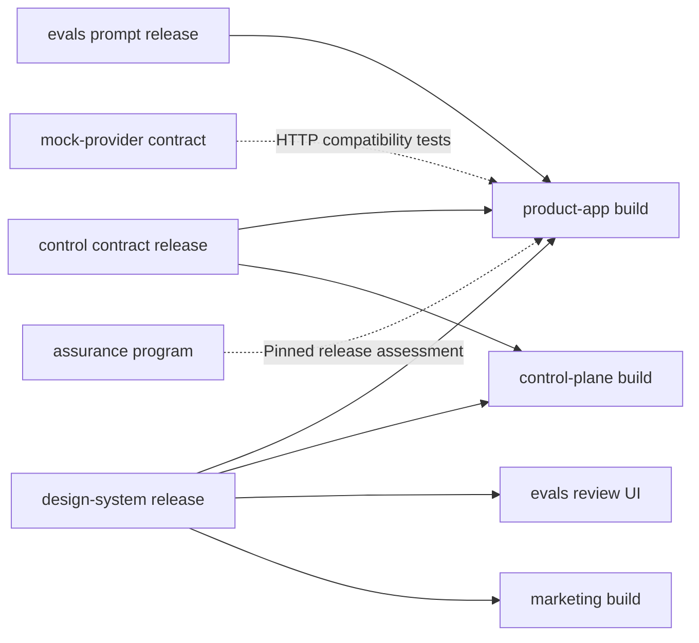

# Repository boundaries and release contracts

This is an optional polyrepo layout for the [reference architecture](README.md). The current starter remains a single repository. A polyrepo is a collection of independently versioned repositories; any one of them may itself contain a small workspace of apps and packages.

## A reusable repository map

```text
product-workspace/              Coordination directory, not a required build root
  product-app/                 Web, gateway, tenant APIs, domain code and workers
  control-plane/               Staff UI, control API, provisioning, policy contracts
  design-system/               UI primitives, tokens, typography, icons
  evals/                       Evaluation cases, scorers, prompt releases, review UI
  marketing/                   Public presentation and narrow lead intake
  integration-worker/          Optional independently operated collection/scheduling
  mock-provider-a/             Synthetic external API and deterministic scenarios
  mock-provider-b/             Another independently changing provider contract
  assurance/                   Independent control definitions and release evidence
```

These are suggested names and ownership units, not repositories created by this branch. Create a separate mock or integration repository only when its release cadence, access model or contract ownership warrants one.

| Repository           | Owns                                                                                                                                          | Keeps outside its authority                                                                                  |
| -------------------- | --------------------------------------------------------------------------------------------------------------------------------------------- | ------------------------------------------------------------------------------------------------------------ |
| `product-app`        | Customer journeys; API authorization; business invariants; tenant schema/migrations; adapters; ingestion; jobs; MCP/domain integration        | Fleet provider credentials, staff grants, synthetic provider implementation                                  |
| `control-plane`      | Staff permissions; tenant registry; desired provisioning/policy; provider orchestration; release/publication receipts; versioned control DTOs | Customer membership grants by implication, business records, customer external-account secrets               |
| `design-system`      | Accessible primitives; themes; semantic tokens; icons; component examples                                                                     | Product routes, API clients, auth, commercial permissions and domain-specific workflows                      |
| `evals`              | Synthetic cases; suites; scorers; cost/latency ledgers; declarative prompts; review artifacts                                                 | Customer application runtime credentials, canonical business schemas, permission enforcement and write rules |
| `marketing`          | Public content; branding; accessibility; narrowly scoped lead capture                                                                         | Customer database credentials or a public route into the tenant API                                          |
| `integration-worker` | Provider schedules; cursors; leases; bounded delivery attempts and receipts                                                                   | A second authoritative customer-content database                                                             |
| `mock-provider-*`    | Declared provider read/write subset; synthetic accounts; pagination; faults; deterministic data                                               | Real credentials, live provider certification or application integration acceptance                          |
| `assurance`          | Invariant/control catalog; isolated checks; evidence packaging; known coverage gaps                                                           | Owning-app enforcement, guaranteed certification or implied production access                                |

## Code structure inside the product repository

Keep tightly coupled business code together. A useful product workspace contains `apps/web`, `apps/gateway`, `apps/tenant-api`, `apps/workers`, and server-only domain, persistence and integration packages. This is a possible future layout, not a migration of the starter's current directories. Several handlers can ship in one artifact initially.

The browser imports the design system, browser-safe auth entry points, an HTTP client and transport DTOs. The API imports server auth, domain services, persistence and provider adapters. A transport contract package may be shared, but database rows and server helpers must not leak through it. Do not move the product domain into a universal shared package to make repository imports easier.

An MCP adapter belongs with the service that owns the operations it exposes. A separate MCP repository is useful only when it has independent ownership and a stable public service contract. Otherwise it duplicates release coordination while changing nothing about the authorization boundary.

## Why split, and when to wait

| Trigger                                                                      | Useful split       | Cost to accept                                                |
| ---------------------------------------------------------------------------- | ------------------ | ------------------------------------------------------------- |
| Several UIs need consistent controls and accessibility fixes                 | Design system      | Version bumps and consumer upgrades                           |
| Evaluations need experiments and report retention independent of app deploys | Evals              | Paired-revision evidence and prompt compatibility             |
| Staff tooling needs privileged cloud access                                  | Control plane      | Additional security, recovery and lifecycle surface           |
| An external API has independent fixtures and compatibility changes           | Provider mock      | Keeping simulator and adapter contracts aligned               |
| Collection schedules have independent ownership or availability needs        | Integration worker | Distributed retries, delivery auth and receipt reconciliation |
| Public content changes much more often than authenticated application code   | Marketing          | Cross-site design/package coordination                        |

Keep modules together when changes routinely require lockstep edits, there is one small owning team, or boundaries are still moving. Avoid a repository per customer, table, function or model prompt. A dedicated deployment does not need a dedicated source fork.

## Three kinds of cross-repository contract

**Build-time packages:** publish immutable UI, prompt and control-contract artifacts with package version, producer commit and content digest. Use a registry or a committed archive plus provenance manifest and lockfile. Consumers pin exact releases and verify integrity. A clean producer source revision and explicit version bump make a release reproducible; floating branches and source symlinks do not.

**Runtime interfaces:** version HTTP/tool/event schemas, define auth and lifecycle binding, specify error/retry behavior, and negotiate compatible versions. The owning service validates again even when callers share its schema library. Schema compatibility includes field meaning, enum behavior and authorization, not just whether JSON parses.

**Operational interfaces:** provisioning and release tooling operate on explicit resource bindings and desired-state documents. Every effect needs an operation identity, expected revision, recorded outcome and reconciliation path. Customer cell rollout and shared route publication coordinate through an ownership lock or compare-and-swap generation.



Arrows denote consumption, not permission to share databases. Contract ownership may stay inside its producer repository; a separate universal contracts repository is optional and often unnecessary.

## Releasing a coupled change

1. Agree on the contract and its compatible old/new behavior. Add additive fields or a parallel version before removing existing ones.
2. Test and release the producer from committed source. Record the artifact digest and support range.
3. Upgrade each consumer explicitly. Run its types/build and the relevant integration journey against the intended producer version.
4. Deploy compatible consumers and providers in a documented order. For a breaking change, use parallel versions or a coordinated migration window with explicit rollback limits.
5. Retire the old contract only after the fleet manifest shows no remaining dependents. Database migrations use expand/migrate/contract phases while old and new runtimes coexist.

Record a release manifest containing product source, UI/prompt/control versions and digests, database migration version, deployment artifact identity, lifecycle and affected cell identities. A library release does not prove consumer readiness; a control-contract release does not prove a tenant has applied the policy.

## Repository operations

Every repository owns its local build and checks. An optional coordinator can clone pinned versions, execute paired tests and assemble manifests without turning sibling directories into runtime dependencies. Use isolated worktrees for concurrent changes and stable task links for coupled reviews; the exact ticket, branch and pull-request convention can fit the adopting team.

A CI system can automate the same checks when useful. Neither a required CI vendor nor a mandatory approval workflow is part of this reference. Keep a reproducible local/pre-release path. Restricted infrastructure credentials belong only to the trusted release/provisioning runner, never to untrusted branch builds.
