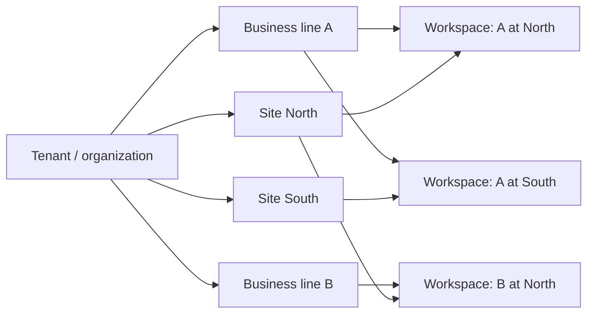
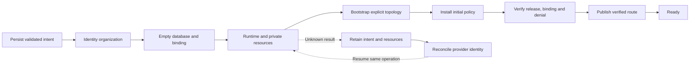

# Tenants, control plane and runtime

This guide describes a provider-neutral expansion of the [cell architecture](README.md). The executable starter currently has a dedicated customer web application, API and database, with manual provisioning. The gateway, topology model, control plane, signed policies and fleet workflows below are **reference designs, not implemented starter features**. [ADR 0008](../adr/0008-optional-polyrepo-platform.md) approves documenting this expansion; adoption requires a separate implementation decision and verified migration.

## Separate customer identity from business topology

A **tenant** is the customer security and resource boundary. An **organization** represents customer ownership and membership; this reference uses one organization per tenant. A person can belong to several organizations without those organizations sharing data. Identity-provider membership establishes affiliation; application grants establish permitted actions and workspaces.

Inside the tenant, keep business dimensions independent:

| Term          | Meaning                                              | Possible domain mapping                        |
| ------------- | ---------------------------------------------------- | ---------------------------------------------- |
| Business line | A distinct activity, offering or organizational unit | Brand, practice, department, product line      |
| Site          | Where an activity operates                           | Office, facility, region, virtual service area |
| Workspace     | An explicitly created business-line/site pair        | Practice at a clinic, department at a facility |
| Group         | Optional collection for reporting or administration  | Region, portfolio, division                    |

Two lines and two sites permit four possible workspaces; they do not automatically create all four. A line can operate at several sites, and several lines can share a site. Explicit pairings avoid accidental grants and empty operational units. Groups should not imply shared storage, inherited permissions or consolidated accounting unless the domain defines those rules.

Each workspace has stable identity independent of its display name. Shared equipment, catalogs, stock or financial balances need explicit resource ownership and transaction rules; physical proximity does not establish those relationships. Start with fewer dimensions when the domain does not need this topology.

## Place tenants in cells

A cell packages a tenant's API execution, restricted database access, private objects and background-work bindings. Deploy the same product source repeatedly with explicit tenant and lifecycle configuration. Do not fork source or customize schemas per customer. A staged rollout can temporarily run compatible schema versions, with recorded migration progress and a common schema lineage.

The dedicated database is a credential and recovery boundary. Runtime credentials must reach only their intended customer database and must not possess schema-owner or provisioning authority. Separate migration credentials are used through a controlled release procedure. A persisted database binding should identify tenant, identity organization, lifecycle and preview identity; the runtime validates it before using customer records.

A cell is a logical deployment boundary, not a promise of one machine. One repository may produce many cells; one cell may contain several HTTP functions and workers. Shared compute can host isolated runtimes when its credentials, scheduling and provider guarantees support the intended threat model. Do not equate a separate function name with demonstrated isolation. Dedicated projects or accounts can provide stronger operational boundaries at greater cost.

## Route requests and authorize again

The starter's direct customer-to-cell route remains valid. An optional shared gateway helps users discover and switch among several authorized tenants. It stores trusted route metadata and identity-verification configuration, without customer database, private-object, queue or integration credentials.

For the gateway variant, the request path is:

1. The browser presents a verified session and requests a tenant/workspace.
2. The gateway validates issuer, audience and session, checks current membership, and resolves the tenant in an operator-controlled registry.
3. It forwards only to the registry's fixed immutable deployment destination, preserving the user's verifiable authority. Request bodies and headers cannot choose arbitrary upstreams.
4. The tenant API independently verifies identity and membership, confirms its fixed tenant binding, and resolves application grants for the requested operation and workspace.
5. Domain services intersect those grants with local capability policy and execute through a scope-bound repository.

Discovery returns only authorized workspaces. Use bounded fanout, timeouts and explicitly modeled partial availability so one unavailable cell need not masquerade as lost membership. Strip untrusted forwarding metadata and reject upstream redirects that could escape the registry.

Capture immutable scope when creating a command, upload, proposal or job. Store that scope with the work; a later browser workspace switch cannot retarget it. Database transactions can reinforce the boundary with transaction-local identity/scope and row-level controls. These complement dedicated storage; they do not justify replacing it silently. Signed provider callbacks use their own narrowly defined verification path and cannot become a general authentication bypass.

## Give the control plane bounded authority

The control plane operates the fleet. It owns staff grants, provisioning requests, resource references, desired policy, rollout state, sanitized operation receipts and audit history. It may hold a projection of business topology for administration, while the tenant database remains authoritative for that topology and its revisions.

Keep business records, documents, customer integration secrets and ordinary encryption keys outside the control database. Usage counters need explicit semantics: completed provisioning operations are not customer transaction totals or billing evidence. Missing observations are unknown, not zero.

Separate the staff UI/control API from the privileged provisioning worker. The API authenticates staff, validates commands and persists intent with restricted database permissions. The worker receives narrowly scoped provider authority and signing authority. Schema bootstrap, release coordination and customer runtime use separate principals. Staff access never silently creates customer membership; owner assignment and any invitation are explicit, separately authorized operations.

Topology changes are commands to the tenant, not direct edits to its tables. Carry an expected topology revision, reason and stable request identity. Commit topology changes and their metadata outbox atomically, then update the control projection from confirmed tenant results. Pending or ambiguous delivery must not replace the last confirmed projection.

## Distribute policy without making every request depend on administration

A proposed policy envelope contains protocol version, issuer/audience, tenant/lifecycle/preview binding, revision, issued time, capability grants, denies, pause state, limits, optional freshness deadlines, key identifier and signature. This is an **illustrative contract**, not a shipped API or schema. Define canonical serialization, maximum size, supported algorithms and compatibility before implementation.

The worker durably records the exact signed envelope before delivery. The tenant verifies its signature, binding, time rules and monotonically increasing revision, then stores it locally. Identical replay is harmless; changed content at the same revision is rejected. Acknowledgment advances the control plane's applied revision. Desired policy, applied policy and tenant topology have distinct revision counters.

Effective permission requires all applicable conditions: implemented capability, actor grant, workspace scope, commercial entitlement, rollout eligibility and no effective deny or pause. Unknown or unimplemented capabilities deny even if a plan includes them. A commercial upgrade never creates user permission, and a feature flag never implements a missing server-side check.

Choose outage behavior by consequence:

| Operation                                                | Proposed behavior during control-plane loss                          |
| -------------------------------------------------------- | -------------------------------------------------------------------- |
| Established core reads and operations                    | Use durable last-verified policy and normal customer authorization   |
| Optional external automation                             | Stop when its signed lease expires; check immediately before effects |
| Provisioning, tier changes and new administrative grants | Remain pending until the control plane recovers                      |
| Unknown policy, invalid signature or wrong binding       | Deny the affected capability                                         |

Cold starts read durable tenant policy; they must not depend on an in-memory control cache. Define maximum tolerable staleness, clock skew, lease renewal and a tenant-local emergency stop. Control independence does not eliminate dependencies on identity verification or membership services; document their availability and revocation behavior separately.

Accept the revocation tradeoff explicitly: a partitioned cell cannot learn a new central deny instantly. Short leases bound exposure but reduce outage continuity. Long-lived core grants preserve service while delaying central revocation. Specify key rotation overlap, removal of compromised keys and recovery from invalid policy. Never renew a lease locally merely because the control plane is unreachable.

## Provision with durable reconciliation

Provisioning is a state machine around external effects, not one long HTTP request. The following sequence is illustrative and must be adapted to the selected infrastructure:

Persist actor, lifecycle, idempotency key and input fingerprint before creating resources. An exact retry returns the original operation; changed input under the same key conflicts. Record each step's identity, status, attempts and sanitized receipt. Start new customers with empty resources; synthetic preview cloning is a different workflow with different authority.

Workers claim operations using leases and fencing tokens. Recheck ownership before state commits and consequential effects; provider idempotency and reconciliation remain necessary because a lease cannot cancel an effect already in flight. On a timeout, inspect provider-owned metadata for the existing resource. Retain ambiguous intents instead of blindly creating replacements. Definitive rejection and unknown completion require different retry behavior.

Keep any secret recovery journal encrypted, access-restricted and protected by conditional writes. The operator should see safe failure categories, retained resources and a way to resume the same request. Destructive compensation needs explicit ownership and retention rules, not automatic deletion after every error.

Publish only after readiness, exact deployment identity and authorization checks pass. Provisioning and ordinary releases both modify routes, so coordinate them through one shared lock/revision protocol. Re-read the registry under that authority, preserve unrelated tenants, stage immutable deployments, and verify publication. Registry updates and provider aliases are not one database transaction: retain publication intents and reconcile partial progress. Lost ownership or stale source stops further shared changes. A repository's local deployment concurrency setting cannot coordinate another repository.

## Assign work to the right execution boundary

| Runtime entry point   | Responsibility and constraints                                                       |
| --------------------- | ------------------------------------------------------------------------------------ |
| HTTP API              | Bounded request validation, authorization and transactional commands                 |
| Queue consumer        | Durable asynchronous work with persisted scope, retries and cancellation checkpoints |
| Scheduler             | Select due work and enqueue stable identities; avoid duplicate external effects      |
| Webhook/callback      | Verify sender and replay identity, persist receipt, then dispatch bounded work       |
| Provisioning worker   | Reconcile infrastructure using separate privileged credentials                       |
| Isolated compute task | Process untrusted files/code with bounded inputs and no business credentials         |

Assume duplicate and delayed queue delivery. Make business commits idempotent, retain receipts and reauthorize the persisted actor where work depends on continuing access. Policy must be checked at use time, especially before external effects. Expose retryable, permanently failed, paused and canceled states. Do not promise cancellation reverses an already committed side effect.

Keep heavy work out of response-lifetime background promises. Use durable dispatch/outbox patterns where database commits and enqueue operations can diverge. A queue, leased job table or workflow engine can implement this contract; select one deliberately. No repository or public endpoint is required for every function.

## Release, recover and retire cells

Separate development, preview, test and production identities, databases, routes, files, queues, signing keys and provider credentials. Infrastructure deployment labels must not infer application lifecycle. Preview builds receive their own deployment-scoped bindings; concurrent previews cannot overwrite shared runtime settings. Production must not clone synthetic data or inherit mock configuration.

A release manifest binds source revision, package digests, schema compatibility, contract versions and lifecycle. Stage tenant runtimes, then any gateway and web artifacts that reference them, before publishing entry routes. Existing cells retain pinned versions until an explicit fleet rollout. Use compatible migrations, small rollout cohorts and rollback criteria; application rollback cannot undo an incompatible schema or external side effect.

Backup, restore and offboarding are **additional proposed operational contracts**. Choose retention and recovery objectives per product. Back up business databases, required private objects and recoverable key material together. Rehearse restores into isolated targets, verify integrity and authorization, and coordinate writer pause, queue replay and route cutover. A restored database must not resend old external actions.

Offboarding should first stop new work, remove discovery, revoke relevant sessions/credentials and drain or cancel jobs. Handle customer export and contractual retention before destroying data, objects, backups or encryption material. Record approved deletion scope and evidence; retain minimal permitted audit metadata. Pausing, archiving and deleting are different states.

Acceptance must test recovery and denial alongside the happy path: wrong tenant/lifecycle, revoked queued actor, duplicate command, response loss, stale policy, concurrent publication, restore and retirement. A health response or successful deployment is useful evidence, but does not prove these workflows. See [adoption](adoption.md) for incremental implementation and verification.
